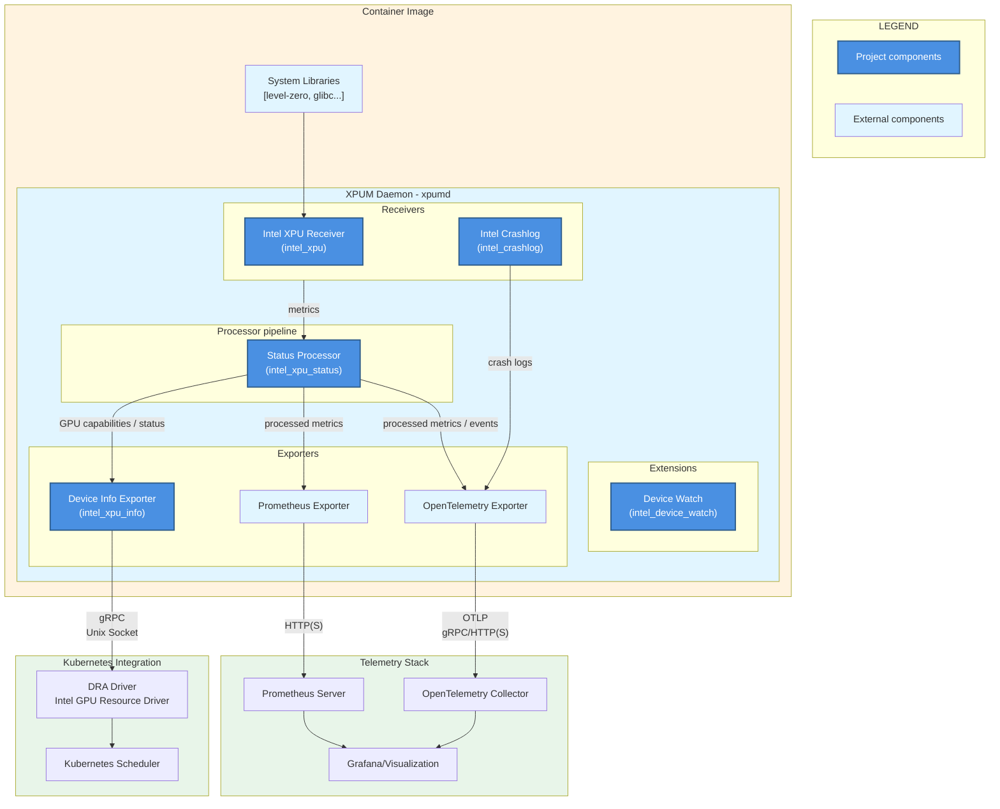

# Intel(R) XPU Manager（XPUM）守护进程

- [简介](#简介)
- [架构](#架构)
- [部署](#部署)
  - [独立部署](#独立部署)
  - [Kubernetes](#kubernetes)
  - [Grafana 仪表盘](#grafana-仪表盘)
- [功能特性](#功能特性)
  - [指标](#指标)
  - [设备信息导出器](#设备信息导出器)
  - [设备监控（Device watch）](#设备监控device-watch)
- [开发](#开发)

## 简介

XPUM（v2.x）守护进程是一个定制的
[OpenTelemetry Collector](https://opentelemetry.io/docs/collector/)，提供：

* Intel GPU 指标导出器
* 面向 Kubernetes Intel GPU 资源驱动的 GPU 状态信息

[Changes](docs/CHANGES.md) 列出了该守护进程与早期 XPUM 版本之间的差异。

## 架构



## 部署

### 独立部署

使用示例配置文件运行 XPUM 守护进程（其中 `$TAG` 为所需的发布标签）：

````bash
docker run -it --rm --user 0 --cap-drop ALL --cap-add PERFMON \
  --device /dev/dri --publish 8080:8080 ghcr.io/intel/xpumanager/xpumd:$TAG \
  --config /etc/xpumd/config-example.yaml
````

对于不需要真实 Level Zero 用户态驱动的集成类运行场景，该镜像还内置了桩（stub）驱动。
详细说明请参阅 [`DEVELOPMENT.md`](docs/DEVELOPMENT.md#testing-container-image-with-stub-driver)。

另请参阅[测试容器镜像](docs/DEVELOPMENT.md#testing-container-image)。

### Kubernetes

部署说明请参阅 [Helm chart](charts/xpumd/README.md)。

有关更完整的遥测技术栈示例，请参阅以下任一文档：

* [MONITORING.md](docs/MONITORING.md) —— 将 XPUM 守护进程与 Prometheus + Grafana 配合使用；或
* [OTEL_STACK.md](docs/OTEL_STACK.md) —— 将 XPUM 守护进程与 OpenTelemetry Collector 后端一同部署

### Grafana 仪表盘

Helm chart 会安装 Grafana 仪表盘，也可以手动将
[dashboard JSON 版本](charts/xpumd/json/)导入 Grafana。


...


## 功能特性

### 指标

支持的 GPU 指标与属性列表请参阅 [`intel_xpu` receiver 文档](receiver/intelxpu/sysman/documentation.md)。

指标的可用性取决于底层宿主硬件、固件、内核及其 GPU 驱动版本，以及用户态 Level-Zero 驱动
（已包含在容器镜像中，参见[驱动发布说明](https://github.com/intel/compute-runtime/releases)）。

该指标集合还会受到宿主内核的限制，具体取决于授予查询指标的（XPUM 守护进程）容器/进程的权限：

* 拥有 GPU 设备文件的写权限：
  - Docker 基础选项：`--device /dev/dri --cap-drop ALL`
  - 所有指标均需要此权限
* 用户/用户组对 GPU 设备文件具有写权限：
  - Docker 选项：`--user 65534:$(awk -F: '/render/{print $3}' /etc/group)`
  - 指标：功耗、频率、显存使用量
* User 0：
  - Docker 选项：`--user 0`
  - 新增指标：温度、显存带宽与 PCIe 带宽
* PERFMON（或 SYS_ADMIN）capability：
  - Docker 选项：`--cap-add PERFMON`
  - 新增 PMU 指标：GPU 引擎利用率
* 访问 MEI 设备：
  - Docker 选项：`$(for dev in /dev/mei[0-9]*; do [ -e "$dev" ] && echo "--device $dev"; done)`
  - 获取部分固件类型信息时需要此权限

> [!NOTE]
> 若在使用 user `0` 和 `PERFMON` capability 时 GPU 利用率指标缺失，或容器启动失败，
> 可能是底层系统（内核或容器引擎）版本过旧，无法支持 `PERFMON` capability。
> 可改用（权限范围更宽的）SYS_ADMIN capability 绕过此问题（`--cap-add SYS_ADMIN`）。

### 设备信息导出器

XPUM 守护进程实现了一个自定义导出器，用于暴露 GPU 能力与健康信息。
它在本地的 Unix socket（默认为 `/run/xpumd/intel_xpu_info.sock`）上提供自定义 gRPC API。

默认配置文件（[`config-example.yaml`](config-example.yaml)）与 [Helm chart](charts/xpumd/README.md)中已启用该设备信息导出器。

### 设备监控（Device watch）

在容器启动之后才出现在节点上的 GPU 无法被该容器使用。
设备监控扩展会周期性地将 sysfs 与设备文件进行比对，
并上报缺失、不可访问或失效的设备。它还可以关闭采集器（collector），
以便在重启时重新枚举设备。

详细的配置与使用说明请参阅 [`intel_device_watch` 扩展文档](extension/inteldevicewatch/README.md)。

## 开发

有关 XPUM 守护进程的构建、运行与测试说明，请参阅 [DEVELOPMENT.md](docs/DEVELOPMENT.md)。
